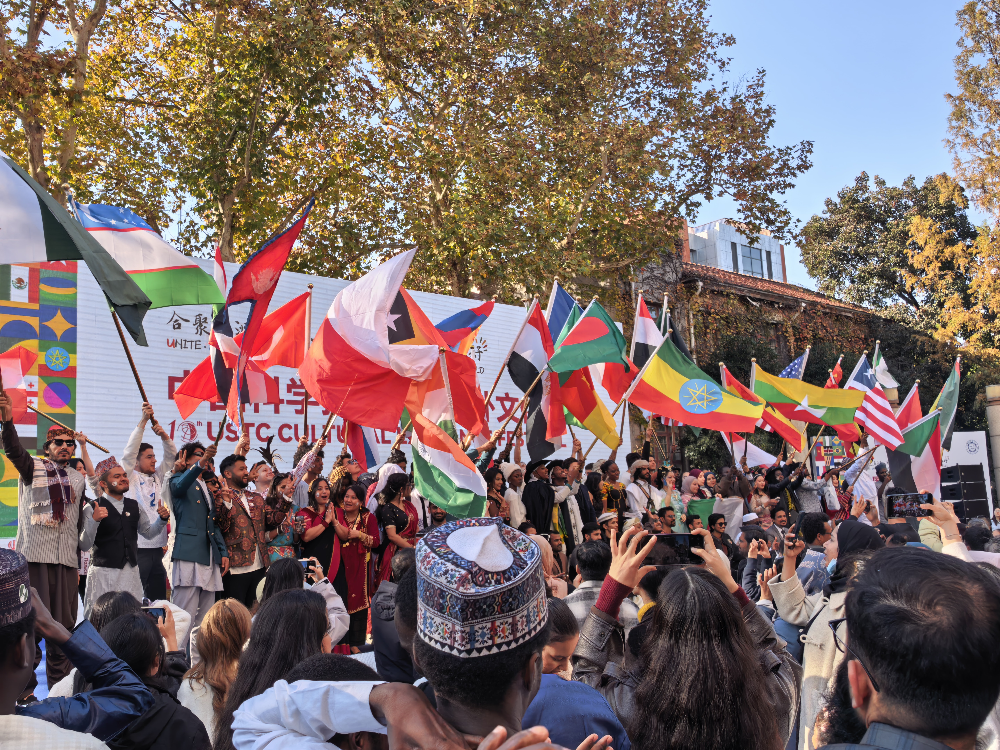
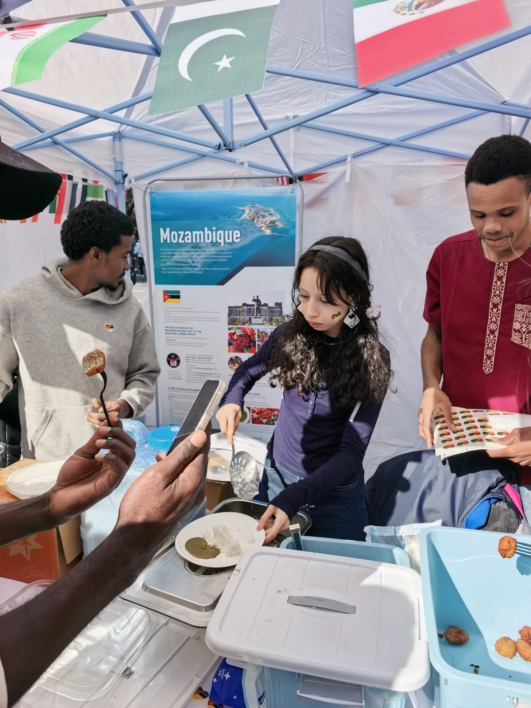
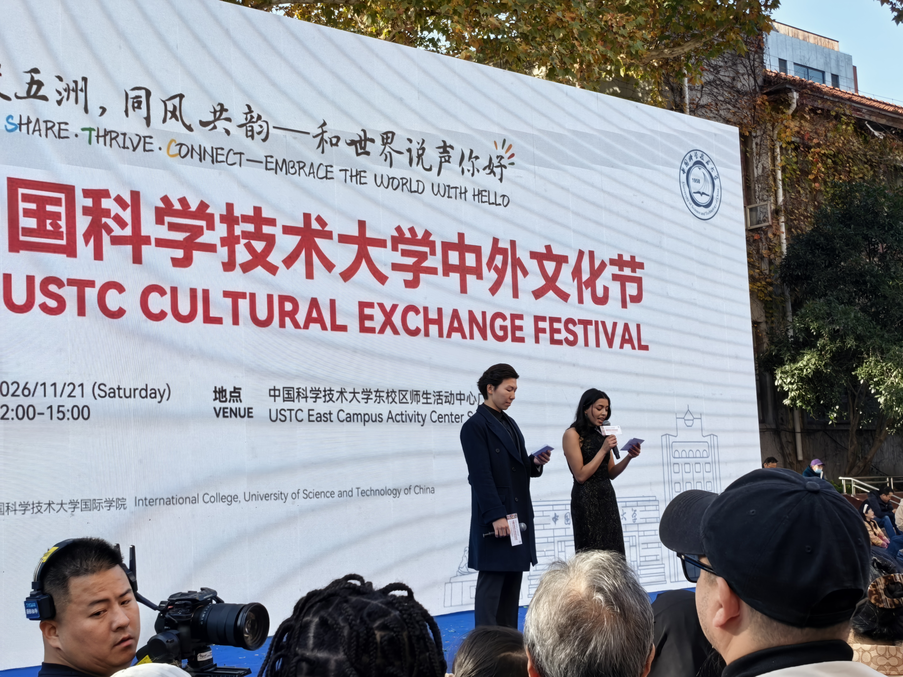
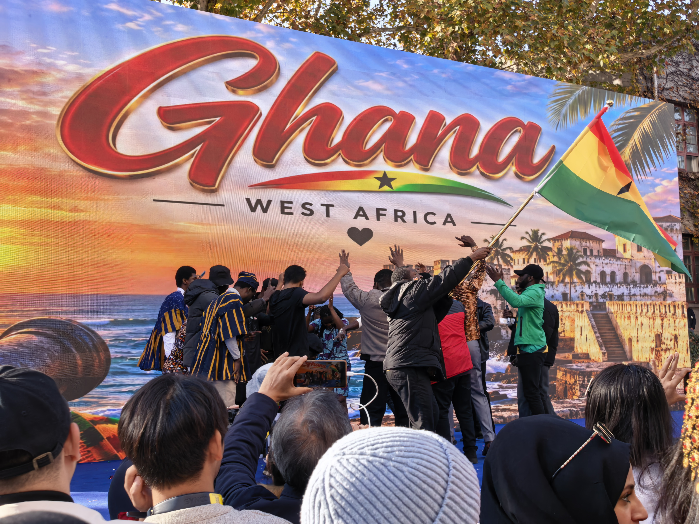
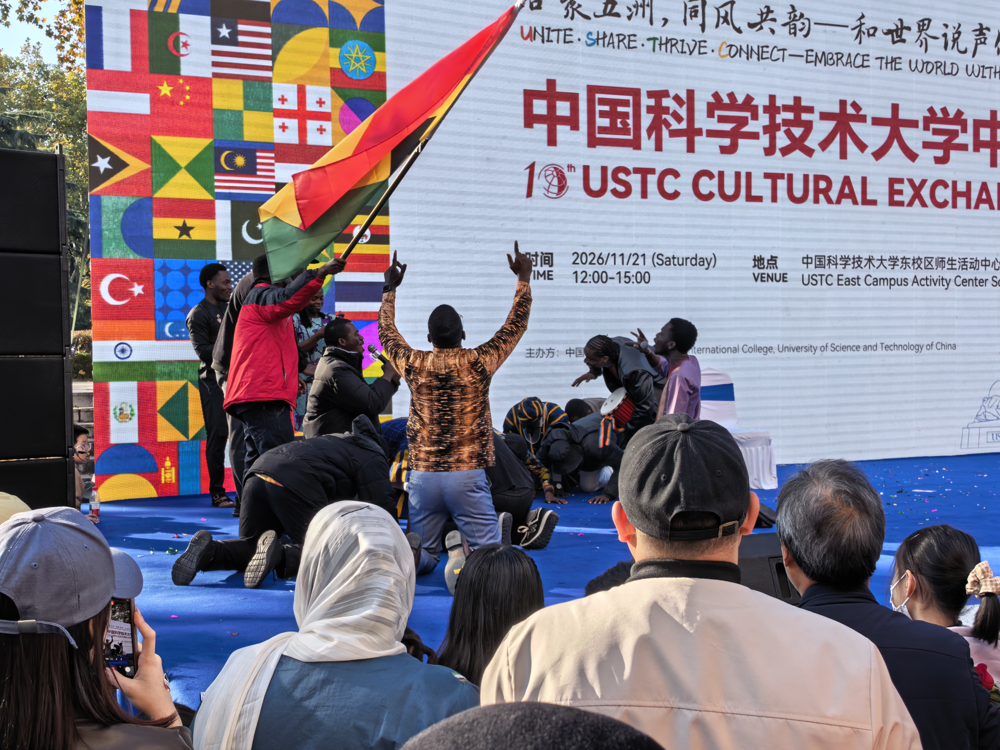
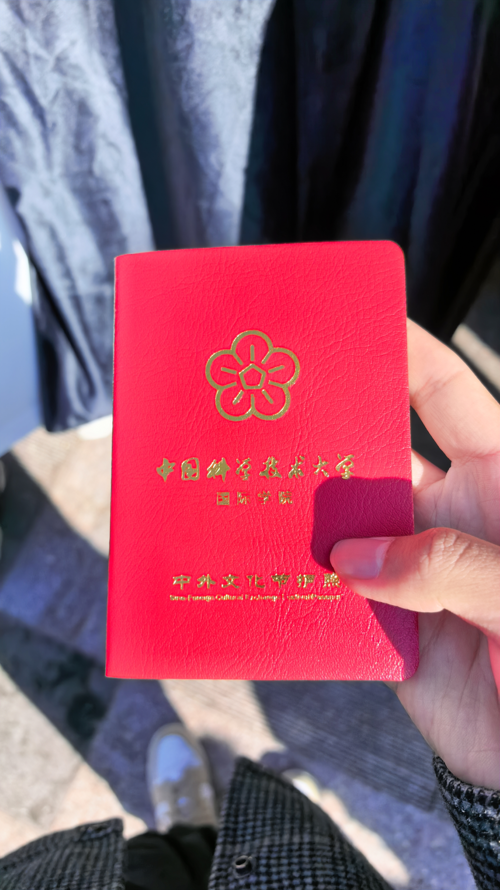
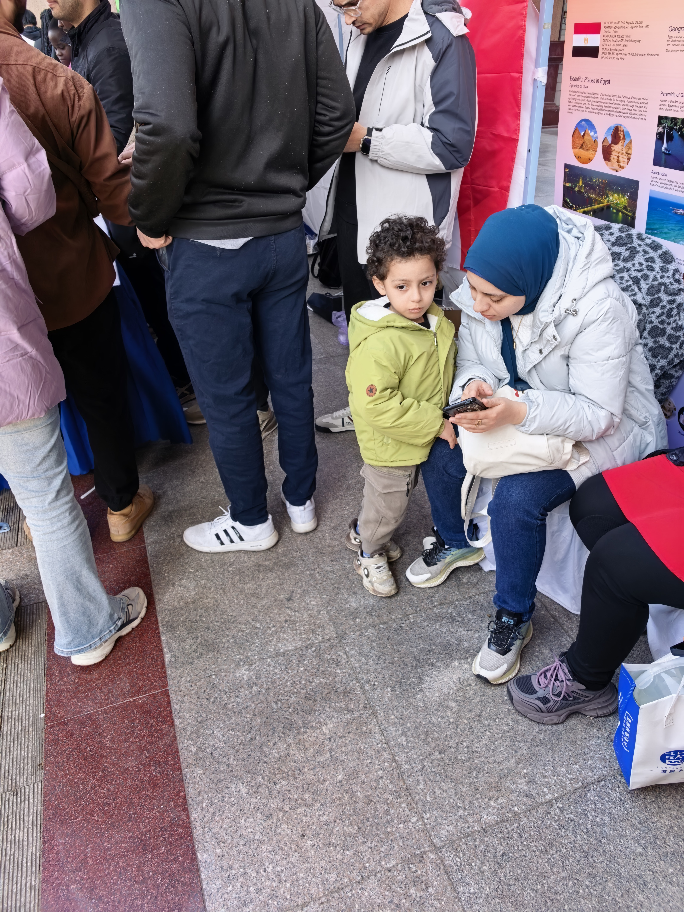
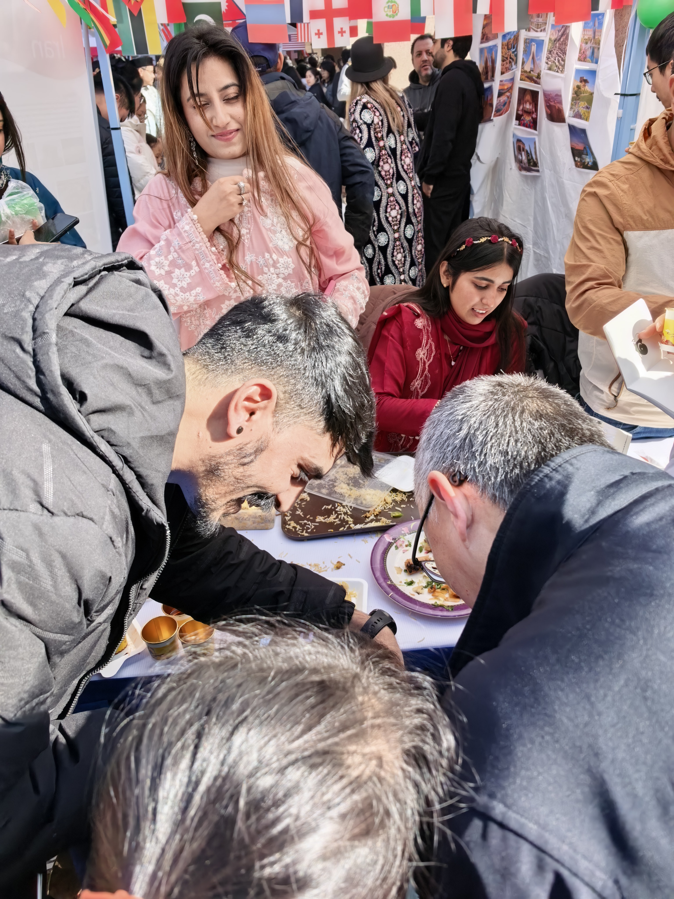
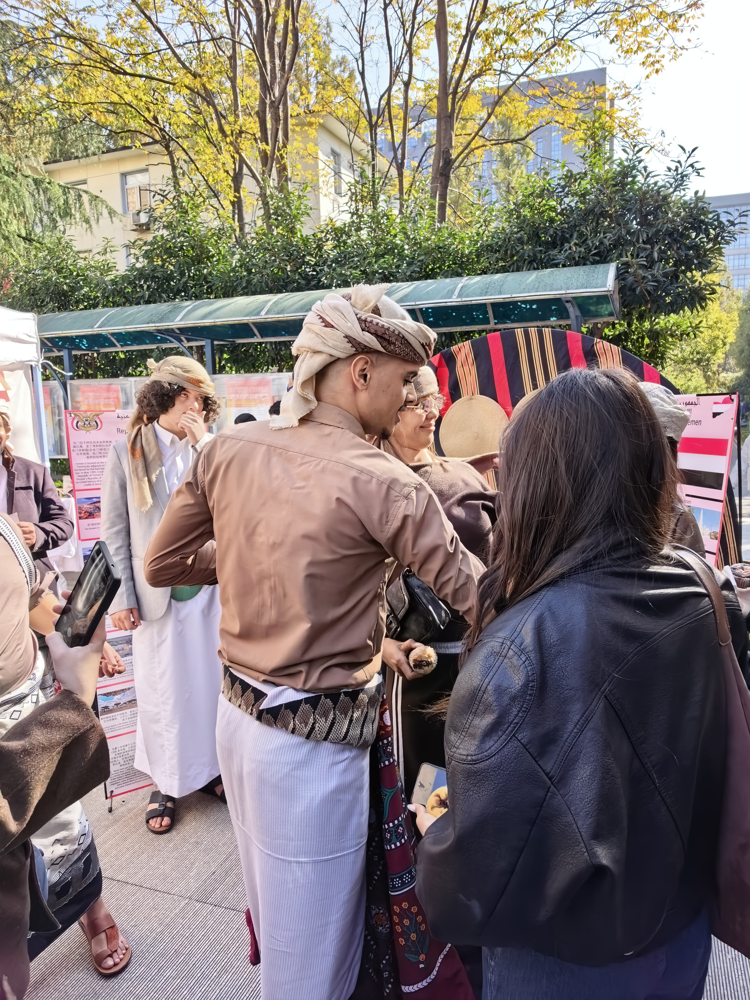
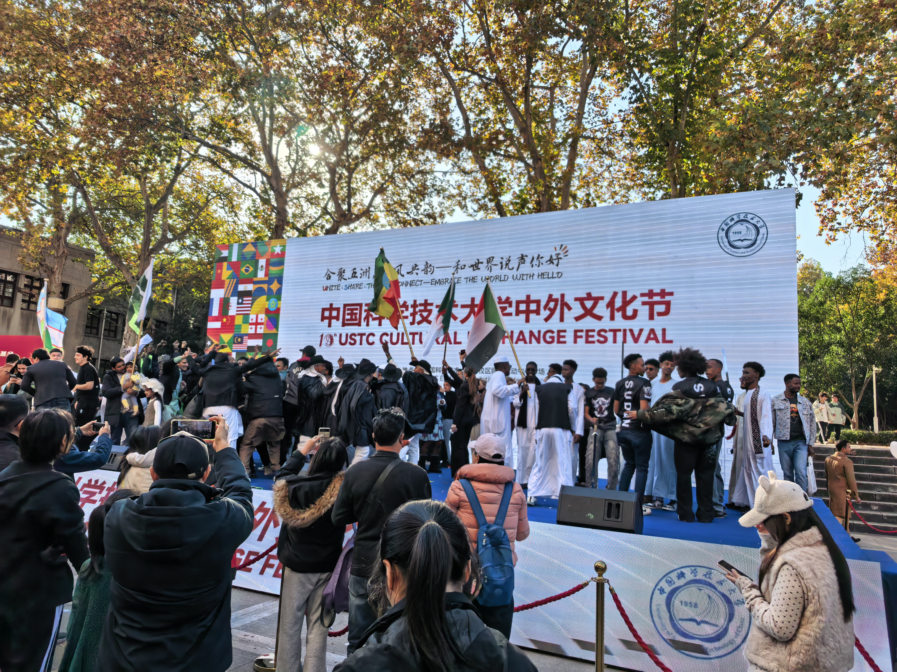

周六去USTC的中外文化节逛了一圈，原本只是想随便看看，结果从头到尾都挺开心，收获了一段很有意思的校园记忆。

现场的国际友人都特别热情，愿意和大家聊天、介绍各自的文化。走到不同的摊位前，可以尝尝来自不同国家的美食，也能听到一些有趣的介绍。那天还喝到一种小果汁，味道有点像山楂——怎么形容呢，挺特别，也有点怪怪的。虽然没完全喝明白它的风味，但这大概就是尝试新东西的乐趣吧。

现场还有节目表演。有些节目气氛特别热烈，大家在台上大喊大叫，我站在旁边一时没太理解这是怎样的表达方式，不过尊重，哈哈。文化嘛，本来就有各种不同的样子；听不懂也没关系，感受一下现场的热闹就很好。

逛活动的时候还和几位外国朋友合了影。短短的交流、友好的笑容，再加上几张合影，让这一天变得格外鲜活。最有成就感的是一路收集印章，最后集满了印章，成功兑换到一个奖品——像完成了一场轻松又有趣的小任务。

美食、表演、合影，还有最后拿到手的奖品，拼在一起就是一个充实又新鲜的周六。很高兴能在熟悉的校园里遇见不同的文化，也很感谢每一位热情参与、愿意分享的朋友。这是一次很棒的经历，也值得用照片好好记下来。

## 活动照片

